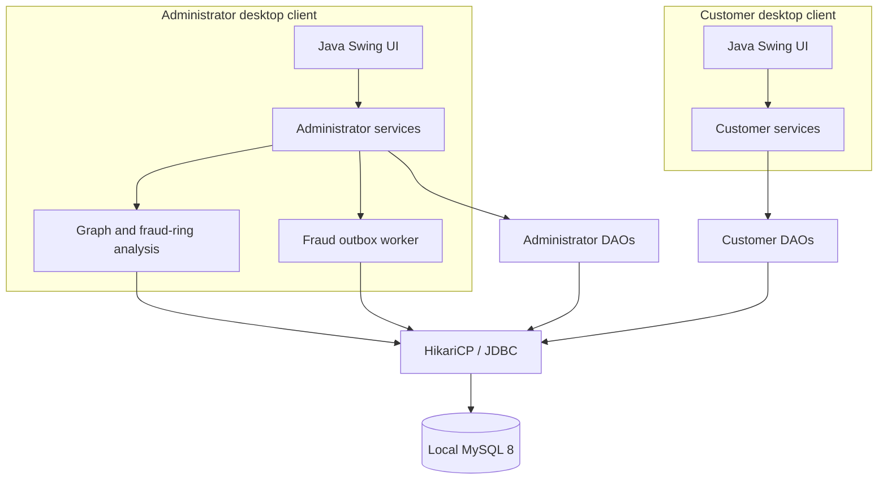

# SecureBank — Java Banking & Fraud-Analysis Simulator

**An educational desktop banking application with transactional JDBC workflows, an administrator console, graph-based fraud investigation, and an offline AI research lab.**

> **Status: local educational release candidate.** SecureBank is not production banking software. It must only use fictional identities and simulated balances on a local, isolated MySQL instance. Do not use real money, real customer data, or an Internet-exposed database.

## Overview

SecureBank is a Java Swing application split into two desktop clients:

- **Customer client** — registration, sign-in, account management, simulated deposits and withdrawals, transfers, transaction history, PIN recovery, and a support inbox.
- **Administrator client** — administrator sign-in, customer and account lifecycle management, transfer review, fraud alerts, durable fraud-event processing, customer-relationship graphs, fraud-ring analysis, reports, and the administrator inbox.

The project is intended to demonstrate software-engineering concepts such as layered application design, JDBC transaction management, database connection pooling, idempotent financial commands, audit history, explainable risk scoring, graph algorithms, and reproducible offline ML experiments.

All demo data is fictional. Fraud scores are heuristic investigation signals; they are not proof of fraud, calibrated probabilities, or automatic grounds for banning a customer.

## Highlights

### Banking workflows

- Customer registration with validation and an atomic customer + first-account + opening-ledger transaction.
- BCrypt-hashed customer PINs and database-backed administrator password hashes.
- Customer session principals and service-layer ownership checks in the desktop application.
- Simulated deposits, withdrawals, and transfers using `BigDecimal` for monetary values.
- Transactional ledger updates and database-backed idempotency for deposits, withdrawals, and transfers.
- Account/customer locking and lifecycle checks inside write transactions.
- Customer support messaging and transaction history.

### Administrator operations

- Customer ban/unban and archive/restore workflows.
- Account lock, closure, and separately approved restoration of accounts closed by customer archiving.
- Lifecycle and account-status audit history.
- Administrator sign-in throttling and guarded administrative service operations.
- Separate customer and administrator runnable JARs, with a shared core JAR.

### Fraud analysis

- **Transaction-level scoring:** weighted rules for large amounts, possible structuring, transaction velocity, unusual hours, balance drain, new accounts, rapid movement, and historical amount outliers.
- **Durable processing:** financial ledger writes and fraud outbox events are committed together. An administrator-side worker processes events asynchronously, records attempts, and supports audited manual retries for failed events.
- **Graph investigation:** transfer relationships, shared-phone links, strongly connected components, bounded cycle search, PageRank, betweenness centrality, and community analysis.
- **Explainability:** rule codes, score contributions, and human-readable explanations accompany investigation results.
- **Isolation Forest:** graph-level anomaly scoring is disabled for incomplete snapshots or insufficient baselines. Its output is a review signal, not a fraud verdict.

### Offline AI research lab

The optional `research/` module contains reproducible experiments that use synthetic data and do not connect to MySQL or modify application records:

- Graph anomaly comparisons involving the existing Java scoring, scikit-learn Isolation Forest, and a PyTorch one-class autoencoder.
- Synthetic software-issue classification using TF-IDF with Logistic Regression and Multinomial Naive Bayes.
- An optional DistilBERT fine-tuning implementation. **The transformer pipeline has not been experimentally executed for this release.**

See [the research guide](research/README.md) and [recorded synthetic results](research/results/RESULTS.md). The datasets are small and artificial; they do not establish real-world fraud-detection or issue-classification performance.

## Architecture



The desktop clients connect directly to MySQL using separate database accounts and table-level grants. Customer principals and service guards are application-layer controls only; they are **not** a server-enforced authorization boundary. Anyone who can access the client machine's database credentials can bypass the Swing UI and issue SQL directly. A real deployment would require a trusted server-side API and authorization layer.

## Technology stack

| Area | Technologies |
| --- | --- |
| Application | Java 17+, Swing, JDBC |
| Database | MySQL 8.0.18+ / InnoDB |
| Connection pool | HikariCP |
| Credential hashing | jBCrypt / BCrypt |
| Build | Apache Ant, Maven dependency resolution, NetBeans project metadata |
| Java tests | Dependency-free test harness and JDBC proxies/fakes |
| Research | Python 3.11–3.13, NumPy, pandas, scikit-learn, matplotlib; optional PyTorch and Transformers |

## Requirements

For the Java application:

- JDK 17 or newer
- Apache Ant 1.10+
- Apache Maven 3.8+
- MySQL Server 8.0.18+ for interactive database use
- Bash on Linux/macOS, or Git Bash on Windows for `run-tests.sh`

For Windows, `BUILD-WINDOWS.bat` and the PowerShell test runner are provided. NetBeans project metadata is included, but the project can also be built from the command line.

For the optional research module:

- Python 3.11–3.13
- Python packages from `research/requirements.txt`
- PyTorch only for the optional autoencoder / deep-research workflow
- Transformers and a local or downloadable pretrained model only for the optional DistilBERT experiment

## Build

The repository intentionally contains source code and dependency metadata, **not prebuilt application JARs or downloaded dependency binaries**. Maven resolves the pinned dependencies into the ignored `lib/` directory.

### Linux / macOS

From the repository root:

```bash
bash scripts/resolve-dependencies.sh
ant clean dist-both
```

The build creates:

```text
dist/
├── CustomerBank.jar
├── AdminBank.jar
├── SecureBankCore.jar
└── lib/                 # runtime dependencies; keep this directory with the JARs
```

Run the offline Java test suites and verify the role-specific packages:

```bash
bash run-tests.sh
bash scripts/check-package.sh
```

`run-tests.sh` also invokes the dependency resolver, so the explicit resolver command can be omitted when running tests first.

### Windows

Install JDK 17+, Ant, and Maven and make `java`, `ant`, and `mvn` available on `PATH`. From the project root:

```bat
BUILD-WINDOWS.bat
```

Run the database-free Java test suites in PowerShell:

```powershell
powershell -NoProfile -ExecutionPolicy Bypass -File scripts\run-tests.ps1
```

### NetBeans

Open this directory as an existing NetBeans project after resolving dependencies. Select JDK 17 or newer in the project settings. The Ant `Clean and Build` target produces the two role-specific application JARs and the shared core JAR. Keep the complete `dist/` directory together when launching either client.

## Local database setup

**Use a disposable local MySQL instance. Back up any existing database before applying a migration. Never run a fresh installer against an existing `bank_system_demo` database.**

### Recommended: interactive installer

Build the project first, start local MySQL, and then:

- Windows: run `SETUP-WINDOWS.bat`.
- Linux/macOS:

  ```bash
  java -cp 'dist/AdminBank.jar:dist/SecureBankCore.jar:dist/lib/*' com.bank.tools.LocalDemoSetup
  ```

The installer:

1. Prompts for a local MySQL administrator account (used for setup only).
2. Refuses to overwrite an existing `bank_system_demo` database or existing application accounts/configuration.
3. Creates the schema and separate customer/admin database users with generated passwords.
4. Prompts for a custom administrator application password.
5. Optionally seeds two fictional demo customers (the default is yes).
6. Writes local credentials to `local/`, which is ignored by Git.

The installer performs MySQL DDL, which is not transactional. If setup fails part-way, inspect the database and local files before attempting any repair; do not blindly rerun it or delete existing data.

Check the local configuration and visible schema tables with:

```bash
java -cp 'dist/AdminBank.jar:dist/SecureBankCore.jar:dist/lib/*' com.bank.tools.LocalDemoSetup --check
```

This is a connectivity/schema-visibility smoke check. It does not prove every write privilege or banking workflow.

### Alternative: manual SQL installation

On a fresh, disposable local MySQL instance, execute `sql/INSTALL_ALL.sql` once as a MySQL administrator. Capture the generated customer/admin database passwords securely and use them in copies of the example files under `local/`.

The manual SQL script creates the fictional administrator login `bankadmin` with password `DemoAdmin!2026` and optional fictional customer records. These are public demonstration credentials. Change the administrator password immediately and never reuse these values elsewhere. The interactive installer is preferred because it asks you to choose the administrator password.

### Existing demo databases

Do not run `01_install_fresh.sql` or `INSTALL_ALL.sql` against an existing database. Review [SQL migration notes](sql/README.md), take a verified backup, and apply only the migrations missing from that database:

| Existing schema | Migration |
| --- | --- |
| Older schema missing recovery/inbox changes | `02_CUSTOMER_RECOVERY_AND_INBOX_UPDATE.sql` |
| P4 schema | `03_customer_lifecycle_archive.sql` |
| P5 schema | `04_fraud_outbox.sql` |
| P6/P7 schema | `05_release_permissions.sql` |

Migrations are one-time operations. MySQL DDL may partially commit. Confirm the schema and grants before proceeding; adapt database usernames/hosts if yours differ.

## Run the applications

Launch the customer and administrator applications in separate processes.

**Windows:**

```bat
START-CUSTOMER.bat
START-ADMIN.bat
```

**Linux / macOS:**

```bash
java -Dbank.db.config=local/customer-db.properties -jar dist/CustomerBank.jar
java -Dbank.db.config=local/admin-db.properties -jar dist/AdminBank.jar
```

Database settings can be supplied through `BANK_DB_CONFIG`, `bank.db.config`, or the default `bank-db.properties` file. `BANK_DB_USER` and `BANK_DB_PASSWORD` override the file values; `BANK_DB_URL` can override the JDBC URL. Pool settings are optional file properties (`db.pool.*`). See [configuration examples](config/) and [security notes](SECURITY.md).

If the interactive installer seeded demo customers, the public fictional logins are:

| Customer | Card number | PIN |
| --- | --- | --- |
| Alice Demo | `401111111101` | `1234` |
| Bob Demo | `401111111102` | `5678` |

These are deliberately public training credentials, not secure example passwords.

## Testing and verification

The current source tree includes **36 Java test suites with 925 passing checks** and **10 Python research tests**. The Java suites use test doubles and JDBC proxies; they do not replace integration tests against a real MySQL server.

Latest local verification for this reviewed source package:

| Check | Result |
| --- | --- |
| Java test runner | 36 suites, 925 checks, 0 failures |
| Ant distribution build | Successful |
| Role-specific package check | Successful; customer/admin/core classes partitioned without duplication |
| Python research tests | 10 passed |
| Live MySQL acceptance | Not performed |
| Windows / NetBeans GUI acceptance | Not performed |
| Dependency vulnerability scan | Not performed |

See [release verification](docs/P8-VERIFICATION.md), the [live acceptance checklist](docs/P8-LIVE-ACCEPTANCE.md), and the [review notes for this package](docs/RELEASE_REVIEW.md). The test counts are assertion counts, not a code-coverage percentage.

## Repository layout

```text
src/                     Java application source
test/                    Database-free Java regression suites
sql/                     Fresh-install SQL, migrations, and read-only checks
config/                  Non-secret configuration examples
docs/                    Architecture, verification, security, and release notes
research/                Offline synthetic ML/NLP experiments and recorded results
scripts/                 Dependency resolution, package checks, and test runners
.github/workflows/       Java CI and offline research CI
nbproject/               NetBeans project metadata
```

## Known limitations

- This is a desktop application with direct JDBC connections, not a server-backed banking system. Table-level grants do not enforce per-customer authorization against an untrusted client.
- Customer session principals are in-process. Cross-process session revocation and server-side authorization are not implemented.
- PIN recovery relies on static identity details and is not strong proof of possession.
- Administrator login throttling is in memory and resets when the process restarts.
- The administrator inbox still performs some synchronous customer lookups and read-status updates on the Swing event thread; very large inboxes or slow database connections may make the UI feel unresponsive.
- Durable idempotency covers deposits, withdrawals, and transfers. Registration and additional-account opening do not yet have durable request idempotency; an uncertain commit must be reconciled before retrying.
- The MySQL SQL scripts and JDBC flows have not been accepted against a live MySQL instance for this release. Windows and NetBeans GUI acceptance is also pending.
- Fraud/AI experiments use synthetic data only. No real-world fraud-detection performance is claimed; the optional DistilBERT pipeline has not been executed.
- No independent security audit or dependency vulnerability scan has been completed.

## Security and responsible use

Read [SECURITY.md](SECURITY.md) before running the application. Never expose MySQL to the Internet, never commit local credentials or database dumps, and never use real customer information. Report suspected vulnerabilities privately to the repository owner.

## License

No project license has been selected yet. Until a license is added, the source is provided for review and educational evaluation only; do not assume that public availability grants permission to redistribute or reuse it. Third-party dependencies retain their own licenses; see [third-party notices](docs/THIRD_PARTY.md).
