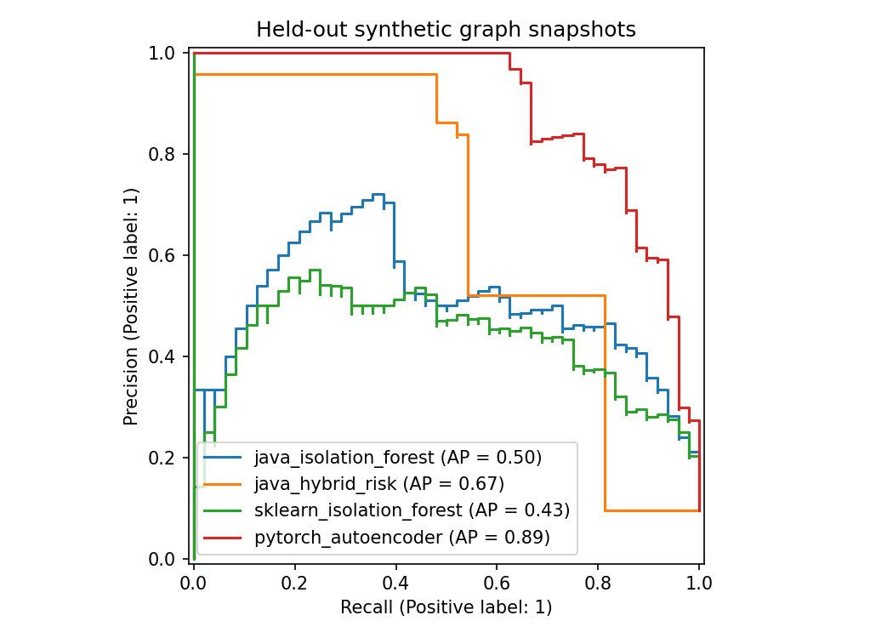
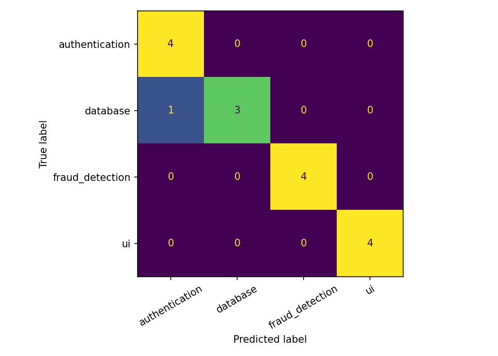

# Recorded synthetic experiment — seed 42

Actual CPU run, Python 3.13.5, NumPy 2.3.5, Pandas 2.2.3, scikit-learn 1.8.0, PyTorch 2.10.0+cpu. See [methodology](../README.md).

## Graph anomaly detection

500 held-out rows, 48 positives. All results synthetic.

| Model | Precision | Recall | F1 | AP | ROC AUC | TP | FP | FN | TN |
|---|---:|---:|---:|---:|---:|---:|---:|---:|---:|
| java_isolation_forest | 0.000 | 0.000 | 0.000 | 0.501 | 0.928 | 0 | 2 | 48 | 450 |
| java_hybrid_risk | 0.000 | 0.000 | 0.000 | 0.671 | 0.885 | 0 | 1 | 48 | 451 |
| java_if_calibrated | 0.528 | 0.583 | 0.554 | 0.501 | 0.928 | 28 | 25 | 20 | 427 |
| java_hybrid_calibrated | 0.520 | 0.812 | 0.634 | 0.671 | 0.885 | 39 | 36 | 9 | 416 |
| sklearn_isolation_forest | 0.481 | 0.542 | 0.510 | 0.427 | 0.909 | 26 | 28 | 22 | 424 |
| pytorch_autoencoder | 0.627 | 0.875 | 0.730 | 0.890 | 0.978 | 42 | 25 | 6 | 427 |

The original fixed thresholds missed all planted positives, despite useful ranking quality. Offline validation calibration improved recall, with additional false positives. No live thresholds were changed. The autoencoder uses known-normal training labels; the Java forest is transductive. These protocols and synthetic assumptions limit comparisons.

## Software issue triage

16 held-out reports from 8 distinct scenarios; authored examples only.

| Model | Macro precision | Macro recall | Macro F1 |
|---|---:|---:|---:|
| tfidf_logistic | 0.950 | 0.938 | 0.937 |
| tfidf_naive_bayes | 0.917 | 0.875 | 0.879 |

DistilBERT: implementation supplied, no executed result. The small synthetic NLP dataset cannot establish generalization to real issues.
